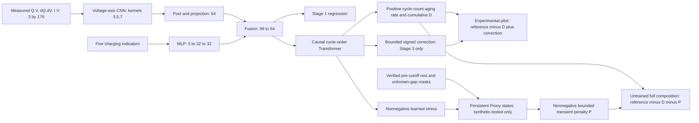

# RAPCT-Prony architecture and execution boundaries

A0–A4 were trained as reduced-budget CALCE pilots. Single/multi-mode memory was tested and fit on declared synthetic traces. The full composition passes synthetic causality, stability and reload tests but has no CALCE joint-training result.

The CNN convolves over physical voltage positions. Each branch has 32 channels, GroupNorm, GELU, a second convolution and GELU. An independent engineered-feature MLP enters only after curve encoding. Scaling is fitted on training batteries; Q is not divided by each cycle's capacity. Uncovered curves are rejected, not extrapolated.

Stage 2 uses length 5, dimension 64, four heads, two layers, FFN 128 and dropout 0.1. Sinusoidal positions represent observed cycle order. Upper-triangular attention and padding masks prohibit future-cycle information. Windows cannot cross source/ordinal/acquisition discontinuities. Frozen and jointly trained cycle encoders were compared using validation only.

Stage 3 uses r=0.001 softplus(g(h)), D_next=D+r on reliable consecutive observed cycle increments, and an encoder-estimated positive initial state at each unknown-history boundary. A global learned reference and bounded signed correction allow measured fluctuations. Correction amplitude and relative rate smoothness are mathematical priors; this is not a battery PDE. Training uses entire chronological target segments, so shuffled minibatches do not create invalid temporal differences. Standalone state carry is tested across adjacent chunks.

Prony times are positive and bounded in log space; weights are normalized softplus amplitudes. Verified rest gives z_after=z_before exp(-duration/tau). Bounded nonnegative stress updates each state while preserving prior state. Without verified rest, a recording-gap duration cannot cause rest decay. Unknown transitions require an explicit current-state initialization. The memory layer accepts and returns carried state rather than implicitly zeroing at each minibatch.

The 0.1 penalty bound and all scales are modeling assumptions, not calibrated electrochemical parameters. Actual CALCE histories fail the conservative memory-continuity gate; the tested synthetic timescale interval 10–1000 s is not claimed as fitted CALCE physics. Individual times are not unique mechanisms.

Full composition uses reference-D-P and reports D, P, modeled rest contribution, availability masks, modes and trajectories. Only full-segment synthetic execution is tested. Arbitrary truncated Transformer-context training, experimental recovery metrics and full joint fine-tuning remain unavailable.
