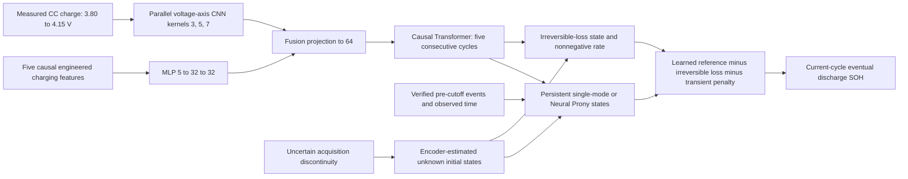

# RAPCT-Prony staged architecture and equation specification

Execution status is determined by gate JSON files and saved results, not by this diagram. The full recovery architecture is conditional on data feasibility; synthetic validation alone supplies no experimental capacity-recovery evidence.

Inputs: curves `[batch, cycle, channel=3, voltage=176]`, engineered features `[batch, cycle, 5]`. The CNN convolves only along measured voltage positions. Channels are integrated Q in Ah, numerical IC in Ah/V and measured I in A. The separate MLP never pretends that adjacent engineered feature positions form a voltage curve. All scaling is fitted inside inner training cells. No per-curve capacity normalization, target smoothing, future discharge input or inferred temperature/impedance/SOC is used.

Stage 1: each CNN branch has two convolutions and GELU, with GroupNorm after the first convolution, 32 initial channels (bounded pilot search also permits 16/64), concatenation, adaptive pooling and 64-dimensional projection. Feature MLP is 5→32→32. Fusion is 96→64 for the initial CNN size. MLP-only, curve-only and fused regressors share current-cycle target IDs; their actual input IDs are saved separately from temporal cohort history.

Stage 2: chronological sinusoidal positions; d_model 64, four heads, two layers, FFN 128, dropout 0.1 initially. A triangular causal mask and padding mask apply at every attention block. The final available token feeds 64→32→1 regression. Frozen encoders can be cached; joint training retains gradients through raw curves. Attention summaries are descriptive, not proof of causal importance.

Stage 3 planned equations: an encoder-estimated initial degradation `D0=softplus(q(h0))` captures unknown prior loss. A nonnegative rate `r=softplus(g(h))` drives `D(k+1)=D(k)+r(k)` only for verified adjacent observed cycles. Training chunks carry detached D and rate; segment boundaries initialize an unknown state from available charging context. No unobserved interval is assigned zero aging. A learnable positive reference and bounded observation residual permit measured fluctuations without requiring monotone measured SOH. The residual is not called recovered capacity.

An independent state proposal q(h) can be regularized toward accumulated D after the first initialization step. This is a learned consistency prior, not a recurrence compared against itself or an independently measured physical state. Rate variation is another mathematical prior. Log components separately; initial coefficients 0.01 and 0.001 use supervised warm-up through epoch 10, ramp through epoch 30, then full weight. Pilot searches may explicitly shorten this schedule while final pilot fits retain it. A zero-weight control retains the same positive-state architecture. Offset identifiability between learned reference and D0 remains limited.

Recovery stages: a nonnegative bounded penalty persists during active cycling and relaxes only according to explicitly known elapsed-time assumptions. For verified rest, `z_after=exp(-rest_seconds/tau)*z_before`. Active forcing is nonnegative and bounded. A stable zero-order-hold update can preserve bounds without clipping physical measurements. Unknown gaps require an encoder-estimated initialization and an uncertainty flag, not invented zero rest or zero aging. The effective penalty is a positive normalized mixture of modes; learned or fixed positive timescales are model assumptions rather than unique reactions.

The official NPSSL uses fixed decay rates and resets zero state each window. The adaptation adds explicit state input/output, unknown-state initialization, bounded forcing/penalty, separate verified-rest and uncertain-gap treatment and persistent chronological segments. Experimental time ranges must derive from inner training rests only. Synthetic ranges are explicitly artificial. No oscillator PDE, Arrhenius coefficient, impedance law or calibrated SEI constant is imported.

The scientific hypothesis concerns an additional benefit of event-conditioned memory. CNN-Transformer fusion, exponential relaxation, monotone latent aging and degradation decomposition are established ingredients. Neither this name nor their combination is asserted to be publishably novel.
